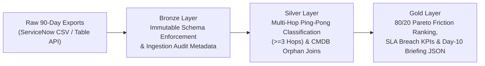

<!--
================================================================================
METADATA HEADER: ENGINEERING & GOVERNANCE ALIGNMENT
Artifact:        02-itsm-medallion-telemetry/README.md
Domain Scope:    site-mfg-01 | enclave-cui-prod | org-enterprise-it
NIST SP 800-171: 3.3.1 (Audit Review & Analysis), 3.4.1 (CMDB Inventory Baseline),
                 3.11.1 (Risk Assessment), 3.12.3 (Continuous Monitoring)
ITIL 4 / PMI:    ITIL 4 Incident Mgmt, Service Request Mgmt, Continual Improvement |
                 PMI Week-1 Bottleneck Quantification & Pareto Prioritization
================================================================================
-->

# Module 02: ITSM Queue & Bottleneck Lakehouse (`02-itsm-medallion-telemetry`)

This module implements the **Bronze / Silver / Gold Medallion Lakehouse** ingestion and analytical pipeline for Week-1 ground-truth verification across ServiceNow queues (`incident`, `sc_task`, `change_request`) and CMDB / MID Server telemetry (`cmdb_ci_server`).

## Medallion Architecture Layers



1. **Bronze Layer (`bronze_*`)**:
   - Ingests raw 90-day ServiceNow exports (`incident`, `sc_task`, `change_request`) and `cmdb_ci_inventory` with schema validation and ingestion timestamps.
2. **Silver Layer (`silver_*`)**:
   - Joins Incident telemetry against CMDB Configuration Items (`cmdb_ci`), flags **"Ping-Pong" tickets** (`reassignment_count >= 3`), and isolates MID Server WinRM discovery failures (`WinRM-5986-Credential-Timeout`).
3. **Gold Layer (`gold_*`)**:
   - Computes the **Pareto 80/20 Friction Ranking** (identifying the exact subcategories driving the majority of total MTTR hours and SLA breaches) and exports `data/gold/medallion_gold_summary.json` consumed directly by the [`04-program-command-gateway/`](../04-program-command-gateway/) control plane.

## Execution

```bash
# Run standalone out-of-the-box Medallion pipeline
python 02-itsm-medallion-telemetry/pipeline.py
```
