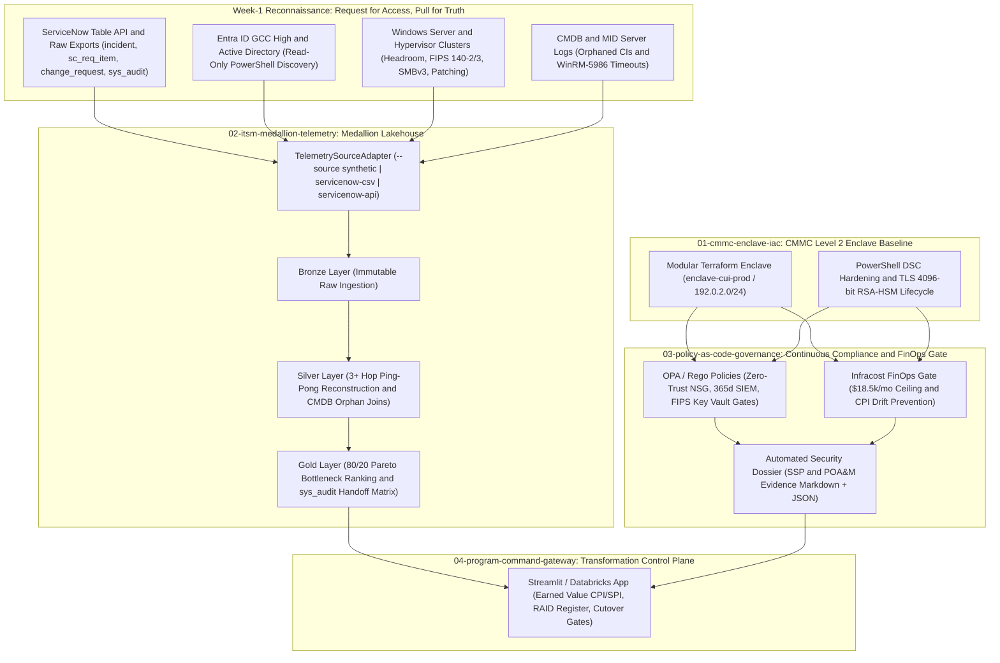
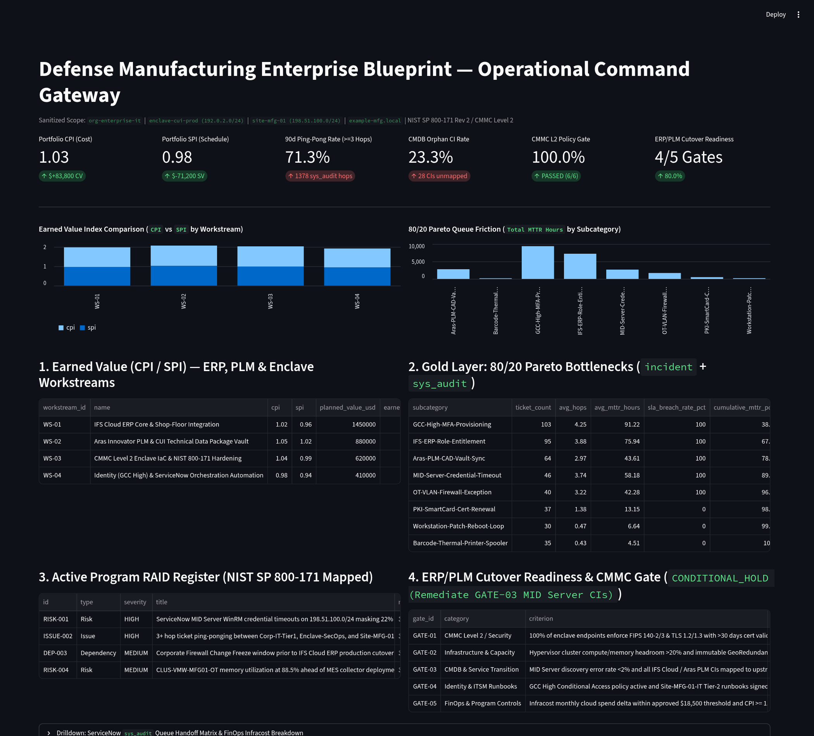
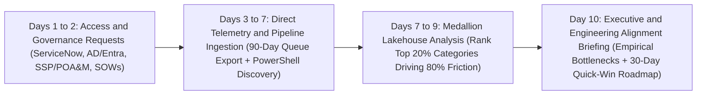

# Defense Manufacturing Enterprise Blueprint & Day-1 Execution Architecture

[](https://freefades2black.github.io/defense-manufacturing-enterprise-blueprint/)
[](https://github.com/FreeFades2Black/defense-manufacturing-enterprise-blueprint/actions/workflows/ci-compliance-gate.yml)
[](scripts/verify_sanitization.py)
[](https://csrc.nist.gov/publications/detail/sp/800-171/rev-2/final)
[-1f6feb?style=flat-square)](https://dodcio.defense.gov/CMMC/)
[](pyproject.toml)
[](LICENSE)

## Executive Summary

Enterprise modernization inside a DoD-regulated manufacturing environment (**NIST SP 800-171 Rev 2 / CMMC Level 2**) fails when program governance and systems engineering operate in separate silos. This repository provides a vendor-neutral, strictly sanitized reference architecture and **Day-1 to Day-30 execution system** unifying **CMMC Level 2 Infrastructure-as-Code (Terraform + PowerShell DSC)**, **Bronze/Silver/Gold Medallion ITSM & CMDB telemetry (PySpark + Delta Lake)**, **Policy-as-Code compliance and FinOps gates (OPA/Rego + Infracost)**, and a **Unified Executive Command Gateway (Streamlit / Databricks App)** for ERP (IFS Cloud) and PLM (Aras Innovator) transformations.

---

## System Architecture & Execution Flow



### Operational Command Gateway (`04-program-command-gateway`) — Live Dashboard Preview



---

## Proof of Quality: Sample Generated Compliance Dossier & Medallion Pareto Output

Every push and pull request runs [`ci-compliance-gate.yml`](.github/workflows/ci-compliance-gate.yml) via `make bootstrap && make pipeline && make audit`. Expand the sections below (or view [`docs/SAMPLE_SECURITY_DOSSIER.md`](docs/SAMPLE_SECURITY_DOSSIER.md)) to inspect the actual deterministic outputs generated by the pipeline:

<details>
<summary><strong>1. View Sample Automated CMMC Level 2 Security Compliance Dossier (Module 03 Output)</strong></summary>

Generated automatically by [`03-policy-as-code-governance/generate_security_dossier.py`](03-policy-as-code-governance/generate_security_dossier.py) (`data/gold/SECURITY_COMPLIANCE_DOSSIER.md` & `data/gold/security_compliance_dossier.json`):

| NIST SP 800-171 Control | Control Family | Technical Requirement | Artifact Verified | ITIL 4 / PMI Outcome | Status |
| :--- | :--- | :--- | :--- | :--- | :---: |
| `3.1.1 / 3.5.3` | Access Control & Identification/Auth | Phishing-resistant MFA (FIDO2/PIV) & compliant device Conditional Access for `enclave-cui-prod` | `01-cmmc-enclave-iac/identity_conditional_access.tf` | ITIL 4 Access Mgmt / Zero Unauthorized CUI Sessions | **PASS** |
| `3.3.1 / 3.3.2` | Audit and Accountability | Immutable SIEM audit workspace with >=365-day log retention and disabled public ingestion | `01-cmmc-enclave-iac/main.tf` | ITIL 4 Information Security Mgmt / C3PAO Audit Evidence | **PASS** |
| `3.4.1 / 3.4.2` | Configuration Management | Mandatory CMDB/FinOps tagging and Windows Server DSC hardening (SMBv1 disabled, SMBv3 signed) | `01-cmmc-enclave-iac/powershell/EnclaveServerBaselineDSC.ps1` | ITIL 4 Service Configuration Mgmt / Drift Prevention | **PASS** |
| `3.8.9` | Media Protection & Recovery | Locked immutable GeoRedundant Recovery Services Vault with public network access disabled | `01-cmmc-enclave-iac/main.tf` | ITIL 4 Service Continuity Mgmt / ERP & PLM Cutover Rollback Safety | **PASS** |
| `3.13.1 / 3.13.6` | System & Communications Protection | Default-deny NSG micro-segmentation across RFC-5737 zones (`192.0.2.0/24`, `198.51.100.0/24`) | `01-cmmc-enclave-iac/network_enclave.tf` | ITIL 4 Infrastructure & Platform Mgmt / Enclave Boundary Isolation | **PASS** |
| `3.13.8 / 3.13.11` | Cryptographic Protection | FIPS 140-2/3 HSM-backed Premium Key Vault, 4096-bit RSA-HSM TLS certs, and Windows FIPS policy | `01-cmmc-enclave-iac/keyvault_tls.tf` | PMI Technical Risk Mitigation / Zero Expired Cert Cutover Outages | **PASS** |

</details>

<details>
<summary><strong>2. View Sample Gold Layer Top-5 Pareto ITSM Queue Bottlenecks & sys_audit Handoff Telemetry (Module 02 Output)</strong></summary>

Generated automatically by [`02-itsm-medallion-telemetry/pipeline.py`](02-itsm-medallion-telemetry/pipeline.py) (`data/gold/gold_pareto_bottlenecks.csv`):

| Subcategory | 90d Tickets | Avg Reassignment Hops | Avg MTTR (Hrs) | Total MTTR (Hrs) | SLA Breach Rate | Cumulative Friction Share |Assignment Group Ping-Pong Path |
| :--- | :---: | :---: | :---: | :---: | :---: | :---: | :--- |
| `GCC-High-MFA-Provisioning` | 112 | 4.46 | 93.89 | 10,515.46 | 100.0% | **37.5%** | `Corp-IT-Tier1 -> Org-Identity-Ops -> Enclave-SecOps -> Site-MFG-01-IT` |
| `IFS-ERP-Role-Entitlement` | 88 | 4.02 | 83.20 | 7,321.52 | 100.0% | **63.7%** | `Corp-IT-Tier1 -> Site-MFG-01-IT -> Enclave-SecOps -> ERP-Platform-Team` |
| `MID-Server-Credential-Timeout` | 53 | 3.96 | 56.83 | 3,012.22 | 98.1% | **74.4%** | `Corp-IT-Tier1 -> Corp-SNOW-Admins -> Enclave-SecOps -> Site-MFG-01-IT` |
| `Aras-PLM-CAD-Vault-Sync` | 58 | 2.97 | 45.77 | 2,654.68 | 100.0% | **83.9%** | `Site-MFG-01-IT -> Corp-Storage-Team -> PLM-Engineering-Support` |
| `OT-VLAN-Firewall-Exception` | 52 | 2.83 | 43.39 | 2,256.37 | 92.3% | **91.9%** | `Site-MFG-01-IT -> Corp-Network-Eng -> Enclave-SecOps` |

> **Diagnostic Finding**: Just **3 subcategories** (`GCC-High-MFA-Provisioning`, `IFS-ERP-Role-Entitlement`, and `MID-Server-Credential-Timeout`) account for **74.4% of total MTTR queue hours** due to 4+ hop ticket ping-ponging across corporate and enclave boundaries.

</details>

---

## Single-Command Quickstart (`Makefile`)

The root [`Makefile`](Makefile) provides a single-command developer experience for bootstrapping, executing the Medallion and Policy-as-Code pipelines, running the compliance/sanitization test suite, and launching the Streamlit Command Gateway:

```bash
# 1. Install dependencies & generate 90-day synthetic ServiceNow (incident, sc_req_item, change_request, sys_audit) + CMDB fixtures
make bootstrap

# 2. Run Module 02 Medallion Lakehouse transformations + Module 03 CMMC Security Dossier & Infracost FinOps gates
make pipeline

# 3. Run RFC-5737 sanitization audit, git log hygiene check, syntax/lint verification, and pytest suite
make audit

# 4. Launch Module 04 Streamlit Transformation & Readiness Command Gateway on port 8501
make gateway
```

### Seamless Transition from Day-1 Synthetic Sandbox to Day-30 Live Telemetry
[`02-itsm-medallion-telemetry/pipeline.py`](02-itsm-medallion-telemetry/pipeline.py) implements a pluggable `TelemetrySourceAdapter` configured via [`02-itsm-medallion-telemetry/config.example.yaml`](02-itsm-medallion-telemetry/config.example.yaml) so the exact same pipeline code transitions untouched from Day-1 sandbox testing to Day-3 read-only CSV exports and Day-30 ServiceNow Table API ingestion:

```bash
# Day 1: Run against deterministic synthetic fixtures
python3 02-itsm-medallion-telemetry/pipeline.py --source synthetic

# Day 3: Run against approved 90-day ServiceNow CSV exports dropped into data/raw/
python3 02-itsm-medallion-telemetry/pipeline.py --source servicenow-csv --config 02-itsm-medallion-telemetry/config.example.yaml

# Day 30: Run against scoped read-only ServiceNow Table API service principal (svc-snow-telemetry-ro@example-mfg.local)
SNOW_RO_API_TOKEN="..." python3 02-itsm-medallion-telemetry/pipeline.py --source servicenow-api --config 02-itsm-medallion-telemetry/config.example.yaml
```

> **Environment Governance Note (`pyproject.toml` vs. `requirements.txt`)**: [`pyproject.toml`](pyproject.toml) is the canonical source of truth for project metadata, optional PySpark/Delta Lake dependencies (`pip install .[spark]`), pytest configuration, and Ruff linter rules. [`requirements.txt`](requirements.txt) is maintained specifically as a strictly bounded manifest for **air-gapped / offline wheelhouse caching** (`pip download -r requirements.txt -d ./wheelhouse`) inside CMMC Level 2 enclave boundaries (`enclave-cui-prod`) where outbound public PyPI internet egress is blocked.

---

## Operational Usage: How This Blueprint Accelerates Day-1 Execution

This repository is a **vendor-neutral reference architecture and operational playbook** designed for hybrid Technical Program Managers and Senior Systems Engineers operating in regulated manufacturing and defense industrial base (DIB) environments (NIST SP 800-171 Rev 2 / CMMC Level 2). 

Rather than being deployed directly into a production enclave, these modules serve as **pre-engineered architectural patterns, diagnostic schemas, and governance templates** that can be rapidly adapted inside an organization's approved internal boundary:

### 1. Week-1 Reconnaissance & Bottleneck Isolation (`02-itsm-medallion-telemetry`)
* **Operational Problem:** New technical leaders often lose their first 60 days relying on anecdotal status reports while ITSM ticket queues stall due to multi-hop reassignments and stale CMDB records.
* **Day-1 Application:** Using the exact ServiceNow table schemas (`incident`, `sc_req_item`, `change_request`, `sys_audit`) and Bronze-Silver-Gold medallion logic defined in Module 02, an engineer can export 90 days of approved read-only queue telemetry into an internal analytics workspace (e.g., Databricks or local Python/SQL) to mathematically isolate the top 20% of ticket categories driving 80% of SLA breaches.

### 2. Non-Disruptive Enclave Auditing (`01-cmmc-enclave-iac`)
* **Operational Problem:** Inheriting hybrid Windows Server, Active Directory, and Entra ID environments without an accurate baseline creates hidden technical debt ahead of ERP/PLM transformations.
* **Day-1 Application:** The read-only discovery patterns and PowerShell DSC hardening baselines provide a zero-footprint audit framework to verify compute headroom, patch compliance, FIPS 140-2/3 cryptography enforcement, and stale identity sprawl before proposing infrastructure changes.

### 3. Shifting Compliance Left (`03-policy-as-code-governance`)
* **Operational Problem:** NIST SP 800-171 and CMMC Level 2 evidence gathering is frequently treated as a manual, post-deployment fire drill that delays Change Advisory Board (CAB) approvals.
* **Day-1 Application:** The OPA/Rego policy gates, `Infracost` budget checks, and automated Security Dossier generators demonstrate how to embed compliance verification directly into CI/CD pipelines—giving ISSMs and Corporate InfoSec continuous, auditable artifacts alongside cost-variance guardrails.

### 4. Unified Executive & IPT Command (`04-program-command-gateway`)
* **Operational Problem:** Technical telemetry, cybersecurity POA&Ms, and program Earned Value metrics (CPI/SPI) typically live in disconnected silos.
* **Day-1 Application:** The Streamlit / Databricks App control plane serves as a working UI blueprint for consolidating infrastructure readiness, ITSM resolution trends, RAID risk registers, and ERP/PLM cutover milestones into a single executive readout for Integrated Product Teams (IPTs).

---

## 1. Repository & Modular Architecture Specification

- **Target Repository Name**: `defense-manufacturing-enterprise-blueprint`
- **Sanitization Constraint**: Zero references to specific employers, facilities, or individuals. All artifacts strictly use standardized domain identifiers (`site-mfg-01`, `enclave-cui-prod`, `org-enterprise-it`, `example-mfg.local`) and **RFC-5737 documentation IPv4 ranges** (`192.0.2.0/24`, `198.51.100.0/24`, `203.0.113.0/24`).
- **Engineering-to-Governance Pairing**: Every technical artifact (Terraform module, PowerShell discovery script, PySpark pipeline, OPA/Rego policy) includes a structured metadata header mapping it to a specific **NIST SP 800-171 Rev 2 control ID** and an **ITIL 4 / PMI governance outcome**.

| Module Directory | Module Title | Core Technical & Governance Scope |
| :--- | :--- | :--- |
| [`01-cmmc-enclave-iac/`](01-cmmc-enclave-iac/) | **CMMC Level 2 Hybrid Enclave Baseline** | Modular Terraform and PowerShell DSC/hardening scripts mapped to NIST SP 800-171 Rev 2 controls, Entra ID / Active Directory conditional access, Windows Server/virtualization baselines, and automated TLS certificate lifecycle checks. |
| [`02-itsm-medallion-telemetry/`](02-itsm-medallion-telemetry/) | **ITSM Queue & Bottleneck Lakehouse** | PySpark + Delta Lake (with local analytical engine execution, pluggable Source Adapter, & Jupyter/Databricks notebook) Bronze/Silver/Gold ingestion pipeline using synthetic ServiceNow ticket schemas (`incident`, `sc_req_item`, `sc_task`, `change_request`, `sys_audit`) to detect multi-hop ticket reassignments, SLA breach risks, and CMDB orphan rates. |
| [`03-policy-as-code-governance/`](03-policy-as-code-governance/) | **Continuous Compliance & FinOps Gate** | OPA/Rego zero-trust policy checks paired with automated Markdown/JSON Security Dossier generation and Infracost PR diffs to enforce budget guardrails and audit readiness in CI/CD. |
| [`04-program-command-gateway/`](04-program-command-gateway/) | **Transformation & Readiness Control Plane** | Streamlit / Databricks App operational gateway displaying synthetic Earned Value metrics (CPI/SPI), RAID risk registers, and cutover readiness checklists for ERP/PLM modernization. |

---

## 2. Unified Role Mandate: Technical Authority + Program Governance

This architecture bridges two core functions into a single-threaded technical program leadership model:

1. **Core Enterprise Platforms (ERP / PLM / Hybrid Infrastructure)**:
   - Pair executive schedule/budget delivery for ERP (e.g., **IFS Cloud**) and PLM (e.g., **Aras Innovator**) rollouts with underlying Windows Server, virtualization (VMware/Hyper-V), storage, and hybrid cloud engineering across `site-mfg-01` and `enclave-cui-prod`.
2. **Cybersecurity & Regulatory Compliance**:
   - Embed **NIST SP 800-171 Rev 2**, **CMMC Level 2**, and **SOX** technical controls directly into CI/CD and program milestone gates rather than treating compliance as a post-deployment audit step.
3. **Identity, Collaboration & ITSM Flow**:
   - Eliminate manual provisioning bottlenecks across Microsoft 365 (Exchange Online, Teams, SharePoint, Entra ID, Active Directory) and **GCC / GCC High** boundaries via PowerShell and ServiceNow REST API orchestration.
4. **Operational Handoff & FinOps**:
   - Transition transformation initiatives into steady-state Site IT (`site-mfg-01`) and Business Solutions ownership backed by automated runbooks, self-documenting IaC, and **CPI/SPI** cost governance.

---

## 3. Ground-Truth Verification: What to Pull Directly (Week 1)

Never rely purely on verbal status reports when diagnosing infrastructure capacity or ITSM queue bottlenecks. Once read-only reporting and administrative telemetry permissions are provisioned in Week 1, extract these datasets directly to establish unfiltered baseline truth:

| Data Source | Direct Telemetry Extraction | Operational & Architectural Justification |
| :--- | :--- | :--- |
| **ServiceNow Queues** | Raw CSV/Excel or Table API exports of the last 90 days of Incidents (`incident`), Service Requests (`sc_req_item` / `sc_task`), and Change Requests (`change_request`, `sys_audit`, reassignment counts, SLA breaches) for the defense business unit assignment groups. | Standard dashboards mask ticket **"ping-ponging"** between Corporate IT (`org-enterprise-it`), Site IT (`site-mfg-01`), and Security (`enclave-cui-prod`); raw exports expose exact multi-hop handoff bottlenecks. |
| **Active Directory / Entra ID** | PowerShell read-only discovery queries (`Get-ADUser`, `Get-ADGroup`, stale computer objects, privileged group memberships, and Entra ID sign-in/licensing logs). | Establishes an indisputable baseline of identity sprawl, orphaned accounts, group nesting debt, and manual provisioning overhead. |
| **Windows Server & Virtualization** | Host compute/memory capacity metrics, cluster health, backup/DR job logs, and OS patch compliance levels across the regulated manufacturing enclave. | Verifies hardware and storage headroom before enterprise ERP or PLM workloads enter cutover and production. |
| **CMDB & MID Server Logs** | ServiceNow MID Server discovery error logs (`ecc_agent_log`), credential timeout reports, and orphaned Configuration Items (CIs) mapped to manufacturing sites. | Pinpoints immediately why automated asset dependency mapping is failing without waiting for a formal architecture review. |

---

## 4. Corporate Boundaries & Governance: What to Request From Stakeholders

In a matrixed defense manufacturing enterprise, Corporate IT (`org-enterprise-it`) and Information Security own master tenant boundaries, enterprise vendor contracts, and formal compliance artifacts. Requesting these formally respects chain-of-command boundaries and accelerates cross-team alignment:

- **From Corporate ServiceNow / ITSM Platform Admins**:
  - Request `itil` and **Performance Analytics (PA)** reporting roles scoped to the defense business unit, plus a read-only service account for validating Table API telemetry extraction.
  - *Boundary Note*: Do not request global admin rights to rewrite corporate workflows on Day 1; propose targeted catalog, routing, and Standard Change improvements backed by empirical queue data.
- **From Corporate Information Security & Enclave ISSMs**:
  - Request the current **System Security Plan (SSP)**, the active **NIST SP 800-171 / CMMC Level 2 POA&M** (Plan of Action & Milestones), and the **Shared Responsibility Matrix** defining where Corporate IT controls end and regulated enclave controls begin (see [`docs/SHARED_RESPONSIBILITY_MATRIX.md`](docs/SHARED_RESPONSIBILITY_MATRIX.md)).
- **From Corporate Infrastructure & Network Engineering**:
  - Request current network topology diagrams, firewall boundary rules for the manufacturing sites (`192.0.2.0/24` <-> `198.51.100.0/24`), and **GCC / GCC High** tenant architecture boundaries.
- **From ERP/PLM Vendors & PMO Leads**:
  - Request active **Statements of Work (SOWs)**, integrated master schedules, current **CPI (Cost Performance Index) / SPI (Schedule Performance Index)** financials, and open **RAID logs** (Risks, Assumptions, Issues, Dependencies).

---

## 5. The Week-1 Execution Rule: "Request for Access, Pull for Truth"

Execute the first 10 business days using a disciplined, parallel reconnaissance sequence (full operational templates in [`docs/DAY1_EXECUTION_PLAYBOOK.md`](docs/DAY1_EXECUTION_PLAYBOOK.md)):



1. **Days 1–2 (Access & Governance Requests)**:
   - Submit formal access requests for read-only telemetry (ServiceNow reporting, AD/Entra read access, virtualization consoles) alongside formal document requests to the enclave ISSM, Corporate Infrastructure leads, and PMO stakeholders.
2. **Days 3–7 (Direct Telemetry & Pipeline Ingestion)**:
   - Pull the raw 90-day ServiceNow queue exports and run non-destructive, read-only PowerShell environment discovery scripts ([`01-cmmc-enclave-iac/powershell/Invoke-EnclaveReadOnlyDiscovery.ps1`](01-cmmc-enclave-iac/powershell/Invoke-EnclaveReadOnlyDiscovery.ps1)) across Active Directory, Entra ID, and Windows Server hosts.
   - Feed the extracted datasets into the [`02-itsm-medallion-telemetry/`](02-itsm-medallion-telemetry/) Bronze/Silver/Gold pipeline to rank the **top 20% of ticket categories and infrastructure gaps driving 80% of operational friction**.
3. **Day 10 (Executive & Engineering Alignment Briefing)**:
   - Enter the initial alignment review with the Hiring Manager / Program Sponsor and Infrastructure/Security leads holding both their official governance artifacts (SSP, POA&M, SOWs, network diagrams) and your verified hard telemetry—presenting exact metrics on where tickets stall, where CMDB/infrastructure gaps sit, and the **30-day quick-win remediation roadmap**.
