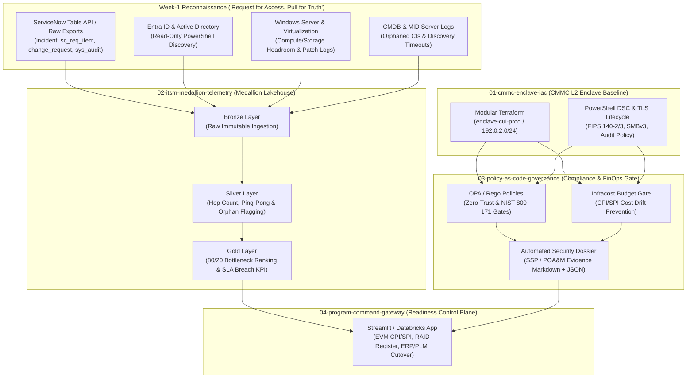
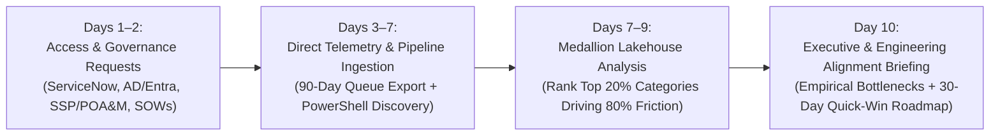

# Defense Manufacturing Enterprise Blueprint & Day-1 Execution Architecture

[](https://csrc.nist.gov/publications/detail/sp/800-171/rev-2/final)
[-1f6feb?style=flat-square)](https://dodcio.defense.gov/CMMC/)
[](#2-unified-role-mandate-technical-authority--program-governance)
[](#1-repository--modular-architecture-specification)

> **Agent Context & Purpose**: This repository defines a vendor-neutral, strictly sanitized reference architecture and Day-1 operational execution plan for a hybrid **Technical Program Manager / Senior Systems Engineer** operating within a DoD-regulated manufacturing enterprise (**NIST SP 800-171 Rev 2 / CMMC Level 2**). It integrates **Infrastructure-as-Code (IaC)**, **Lakehouse ITSM/OT telemetry**, **Policy-as-Code compliance gates**, and **structured Day-1 reconnaissance protocols**.

---

## System Architecture & Execution Flow



---

## Operational Usage: How This Blueprint Accelerates Day-1 Execution

This repository is a **vendor-neutral reference architecture and operational playbook** designed for hybrid Technical Program Managers and Senior Systems Engineers operating in regulated manufacturing and defense industrial base (DIB) environments (NIST SP 800-171 Rev 2 / CMMC Level 2). 

Rather than being deployed directly into a production enclave, these modules serve as **pre-engineered architectural patterns, diagnostic schemas, and governance templates** that can be rapidly adapted inside an organization's approved internal boundary:

### 1. Week-1 Reconnaissance & Bottleneck Isolation (`02-itsm-medallion-telemetry`)
* **Operational Problem:** New technical leaders often lose their first 60 days relying on anecdotal status reports while ITSM ticket queues stall due to multi-hop reassignments and stale CMDB records.
* **Day-1 Application:** Using the exact ServiceNow table schemas (`incident`, `sc_req_item`, `change_request`, `sys_audit`) and Bronze-Silver-Gold medallion logic defined in Module 02, an engineer can export 90 days of approved read-only queue telemetry into an internal analytics workspace (e.g., Databricks or local Python/SQL) to mathematically isolate the top 20% of ticket categories driving 80% of SLA breaches.

### 2. Non-Disruptive Enclave Auditing (`01-cmmc-enclave-iac`)
* **Operational Problem:** Inheriting hybrid Windows Server, Active Directory, and Entra ID environments without an accurate baseline creates hidden technical debt ahead of ERP/PLM transformations.
* **Day-1 Application:** The read-only discovery patterns and PowerShell DSC hardening baselines provide a zero-footprint audit framework to verify compute headroom, patch compliance, FIPS 140-2/3 cryptography enforcement, and stale identity sprawl before proposing infrastructure changes.

### 3. Shifting Compliance Left (`03-policy-as-code-governance`)
* **Operational Problem:** NIST SP 800-171 and CMMC Level 2 evidence gathering is frequently treated as a manual, post-deployment fire drill that delays Change Advisory Board (CAB) approvals.
* **Day-1 Application:** The OPA/Rego policy gates, `Infracost` budget checks, and automated Security Dossier generators demonstrate how to embed compliance verification directly into CI/CD pipelines—giving ISSMs and Corporate InfoSec continuous, auditable artifacts alongside cost-variance guardrails.

### 4. Unified Executive & IPT Command (`04-program-command-gateway`)
* **Operational Problem:** Technical telemetry, cybersecurity POA&Ms, and program Earned Value metrics (CPI/SPI) typically live in disconnected silos.
* **Day-1 Application:** The Streamlit / Databricks App control plane serves as a working UI blueprint for consolidating infrastructure readiness, ITSM resolution trends, RAID risk registers, and ERP/PLM cutover milestones into a single executive readout for Integrated Product Teams (IPTs).

---

## 1. Repository & Modular Architecture Specification

- **Target Repository Name**: `defense-manufacturing-enterprise-blueprint`
- **Sanitization Constraint**: Zero references to specific employers, facilities, or individuals. All artifacts strictly use standardized domain identifiers (`site-mfg-01`, `enclave-cui-prod`, `org-enterprise-it`, `example-mfg.local`) and **RFC-5737 documentation IPv4 ranges** (`192.0.2.0/24`, `198.51.100.0/24`, `203.0.113.0/24`).
- **Engineering-to-Governance Pairing**: Every technical artifact (Terraform module, PowerShell discovery script, PySpark pipeline, OPA/Rego policy) includes a structured metadata header mapping it to a specific **NIST SP 800-171 Rev 2 control ID** and an **ITIL 4 / PMI governance outcome**.

| Module Directory | Module Title | Core Technical & Governance Scope |
| :--- | :--- | :--- |
| [`01-cmmc-enclave-iac/`](01-cmmc-enclave-iac/) | **CMMC Level 2 Hybrid Enclave Baseline** | Modular Terraform and PowerShell DSC/hardening scripts mapped to NIST SP 800-171 Rev 2 controls, Entra ID / Active Directory conditional access, Windows Server/virtualization baselines, and automated TLS certificate lifecycle checks. |
| [`02-itsm-medallion-telemetry/`](02-itsm-medallion-telemetry/) | **ITSM Queue & Bottleneck Lakehouse** | PySpark + Delta Lake (with local analytical engine execution & Jupyter/Databricks notebook) Bronze/Silver/Gold ingestion pipeline using synthetic ServiceNow ticket schemas (`incident`, `sc_req_item`, `sc_task`, `change_request`, `sys_audit`) to detect multi-hop ticket reassignments, SLA breach risks, and CMDB orphan rates. |
| [`03-policy-as-code-governance/`](03-policy-as-code-governance/) | **Continuous Compliance & FinOps Gate** | OPA/Rego zero-trust policy checks paired with automated Markdown/JSON Security Dossier generation and Infracost PR diffs to enforce budget guardrails and audit readiness in CI/CD. |
| [`04-program-command-gateway/`](04-program-command-gateway/) | **Transformation & Readiness Control Plane** | Streamlit / Databricks App operational gateway displaying synthetic Earned Value metrics (CPI/SPI), RAID risk registers, and cutover readiness checklists for ERP/PLM modernization. |

---

## 2. Unified Role Mandate: Technical Authority + Program Governance

This architecture bridges two core functions into a single-threaded technical program leadership model:

1. **Core Enterprise Platforms (ERP / PLM / Hybrid Infrastructure)**:
   - Pair executive schedule/budget delivery for ERP (e.g., **IFS Cloud**) and PLM (e.g., **Aras Innovator**) rollouts with underlying Windows Server, virtualization (VMware/Hyper-V), storage, and hybrid cloud engineering across `site-mfg-01` and `enclave-cui-prod`.
2. **Cybersecurity & Regulatory Compliance**:
   - Embed **NIST SP 800-171 Rev 2**, **CMMC Level 2**, and **SOX** technical controls directly into CI/CD and program milestone gates rather than treating compliance as a post-deployment audit step.
3. **Identity, Collaboration & ITSM Flow**:
   - Eliminate manual provisioning bottlenecks across Microsoft 365 (Exchange Online, Teams, SharePoint, Entra ID, Active Directory) and **GCC / GCC High** boundaries via PowerShell and ServiceNow REST API orchestration.
4. **Operational Handoff & FinOps**:
   - Transition transformation initiatives into steady-state Site IT (`site-mfg-01`) and Business Solutions ownership backed by automated runbooks, self-documenting IaC, and **CPI/SPI** cost governance.

---

## 3. Ground-Truth Verification: What to Pull Directly (Week 1)

Never rely purely on verbal status reports when diagnosing infrastructure capacity or ITSM queue bottlenecks. Once read-only reporting and administrative telemetry permissions are provisioned in Week 1, extract these datasets directly to establish unfiltered baseline truth:

| Data Source | Direct Telemetry Extraction | Operational & Architectural Justification |
| :--- | :--- | :--- |
| **ServiceNow Queues** | Raw CSV/Excel or Table API exports of the last 90 days of Incidents (`incident`), Service Requests (`sc_req_item` / `sc_task`), and Change Requests (`change_request`, `sys_audit`, reassignment counts, SLA breaches) for the defense business unit assignment groups. | Standard dashboards mask ticket **"ping-ponging"** between Corporate IT (`org-enterprise-it`), Site IT (`site-mfg-01`), and Security (`enclave-cui-prod`); raw exports expose exact multi-hop handoff bottlenecks. |
| **Active Directory / Entra ID** | PowerShell read-only discovery queries (`Get-ADUser`, `Get-ADGroup`, stale computer objects, privileged group memberships, and Entra ID sign-in/licensing logs). | Establishes an indisputable baseline of identity sprawl, orphaned accounts, group nesting debt, and manual provisioning overhead. |
| **Windows Server & Virtualization** | Host compute/memory capacity metrics, cluster health, backup/DR job logs, and OS patch compliance levels across the regulated manufacturing enclave. | Verifies hardware and storage headroom before enterprise ERP or PLM workloads enter cutover and production. |
| **CMDB & MID Server Logs** | ServiceNow MID Server discovery error logs (`ecc_agent_log`), credential timeout reports, and orphaned Configuration Items (CIs) mapped to manufacturing sites. | Pinpoints immediately why automated asset dependency mapping is failing without waiting for a formal architecture review. |

---

## 4. Corporate Boundaries & Governance: What to Request From Stakeholders

In a matrixed defense manufacturing enterprise, Corporate IT (`org-enterprise-it`) and Information Security own master tenant boundaries, enterprise vendor contracts, and formal compliance artifacts. Requesting these formally respects chain-of-command boundaries and accelerates cross-team alignment:

- **From Corporate ServiceNow / ITSM Platform Admins**:
  - Request `itil` and **Performance Analytics (PA)** reporting roles scoped to the defense business unit, plus a read-only service account for validating Table API telemetry extraction.
  - *Boundary Note*: Do not request global admin rights to rewrite corporate workflows on Day 1; propose targeted catalog, routing, and Standard Change improvements backed by empirical queue data.
- **From Corporate Information Security & Enclave ISSMs**:
  - Request the current **System Security Plan (SSP)**, the active **NIST SP 800-171 / CMMC Level 2 POA&M** (Plan of Action & Milestones), and the **Shared Responsibility Matrix** defining where Corporate IT controls end and regulated enclave controls begin (see [`docs/SHARED_RESPONSIBILITY_MATRIX.md`](docs/SHARED_RESPONSIBILITY_MATRIX.md)).
- **From Corporate Infrastructure & Network Engineering**:
  - Request current network topology diagrams, firewall boundary rules for the manufacturing sites (`192.0.2.0/24` <-> `198.51.100.0/24`), and **GCC / GCC High** tenant architecture boundaries.
- **From ERP/PLM Vendors & PMO Leads**:
  - Request active **Statements of Work (SOWs)**, integrated master schedules, current **CPI (Cost Performance Index) / SPI (Schedule Performance Index)** financials, and open **RAID logs** (Risks, Assumptions, Issues, Dependencies).

---

## 5. The Week-1 Execution Rule: "Request for Access, Pull for Truth"

Execute the first 10 business days using a disciplined, parallel reconnaissance sequence (full operational templates in [`docs/DAY1_EXECUTION_PLAYBOOK.md`](docs/DAY1_EXECUTION_PLAYBOOK.md)):



1. **Days 1–2 (Access & Governance Requests)**:
   - Submit formal access requests for read-only telemetry (ServiceNow reporting, AD/Entra read access, virtualization consoles) alongside formal document requests to the enclave ISSM, Corporate Infrastructure leads, and PMO stakeholders.
2. **Days 3–7 (Direct Telemetry & Pipeline Ingestion)**:
   - Pull the raw 90-day ServiceNow queue exports and run non-destructive, read-only PowerShell environment discovery scripts ([`01-cmmc-enclave-iac/powershell/Invoke-EnclaveReadOnlyDiscovery.ps1`](01-cmmc-enclave-iac/powershell/Invoke-EnclaveReadOnlyDiscovery.ps1)) across Active Directory, Entra ID, and Windows Server hosts.
   - Feed the extracted datasets into the [`02-itsm-medallion-telemetry/`](02-itsm-medallion-telemetry/) Bronze/Silver/Gold pipeline to rank the **top 20% of ticket categories and infrastructure gaps driving 80% of operational friction**.
3. **Day 10 (Executive & Engineering Alignment Briefing)**:
   - Enter the initial alignment review with the Hiring Manager / Program Sponsor and Infrastructure/Security leads holding both their official governance artifacts (SSP, POA&M, SOWs, network diagrams) and your verified hard telemetry—presenting exact metrics on where tickets stall, where CMDB/infrastructure gaps sit, and the **30-day quick-win remediation roadmap**.

---

## 6. Quickstart: Run the Blueprint Out-of-the-Box

### Step 1: Install Dependencies
```bash
pip install -r requirements.txt
```

### Step 2: Generate Deterministic 90-Day Synthetic Telemetry & CMDB Fixtures
Generates realistic 90-day ServiceNow `incident`, `sc_req_item`, `sc_task`, `change_request`, `sys_audit` logs (with multi-hop reassignments and SLA breaches), CMDB server inventory (`cmdb_ci_inventory`), and ERP/PLM EVM/RAID fixtures:
```bash
python3 scripts/generate_synthetic_telemetry.py
```

### Step 3: Execute the ITSM & CMDB Medallion Lakehouse Pipeline
Runs the Bronze -> Silver -> Gold analytical transformations and produces the Week-1 Pareto bottleneck report and Gold KPI tables:
```bash
python3 02-itsm-medallion-telemetry/pipeline.py
```

### Step 4: Run Continuous Compliance & FinOps Governance Gate
Evaluates CMMC Level 2 infrastructure compliance and Infracost budget guardrails, outputting a timestamped Markdown and JSON **Security Dossier**:
```bash
python3 03-policy-as-code-governance/generate_security_dossier.py
python3 03-policy-as-code-governance/evaluate_finops_gate.py
```

### Step 5: Launch the Transformation & Readiness Control Plane (Streamlit / Databricks App)
```bash
./04-program-command-gateway/launch_gateway.sh
```

### Step 6: Verify Sanitization & Run Automated Test Suite
```bash
python3 scripts/verify_sanitization.py
pytest -v
```
